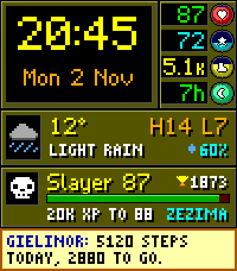
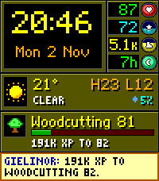
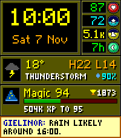
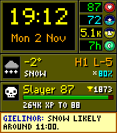
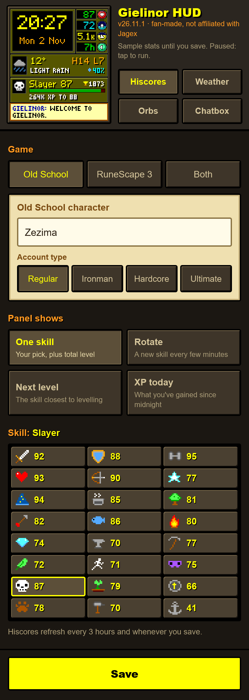

<h1 align="center">Gielinor HUD</h1>

  <b>An Old School RuneScape-inspired watchface for the Pebble Time 2.</b> 
  Your day as a game screen: status orbs, live weather, your real hiscores and a chatbox.

  
  
  
  

  

  
  
  

<!-- PHOTO: replace with a real on-wrist photo of a Pebble Time 2 running the face

-->

## Install

**Pebble appstore (iPhone and Android):** coming soon.
<!-- STORE: replace the line above with the appstore link once the listing is live -->

**Android, direct download:**

1. On your phone, download `GielinorHUD-<version>.pbw` from the
   [latest release](https://github.com/TechnoidAlpha/gielinor-hud-pebble/releases/latest).
2. Open the file. It opens in the Pebble app, which installs it to your watch.
3. In the Pebble app, open the face's **Settings** and enter your character name.

If Android doesn't offer to open the file with the Pebble app, open it from a file manager
instead, or use [Rebble's Sideload Helper](https://help.rebble.io/sideloading/).

**iPhone:** please use the appstore link once it is live. iOS can't open a downloaded `.pbw`
reliably.

## Features

- **Big pixel clock** and date in an original OSRS-style font with drop shadows. Follows your
  watch's 12/24-hour setting.
- **Live weather**: temperature, conditions, today's high and low, and the chance of rain or
  snow. Uses your phone's location or a city you choose.
- **Your real hiscores**, for Old School RuneScape or RuneScape 3.
- **Chatbox** with useful messages: when rain is due, steps left to your goal, XP to your next
  level, a low-battery warning, and a notice if your phone disconnects.
- **Gentle on battery**: it redraws once a minute, and your phone does all the fetching.
- **No accounts, no API keys, no ads.**

### Status orbs

Coloured green to red, like the game's.

| Orb | Shows |
|:---:|-------|
|  Hitpoints | Watch battery (cyan while charging) |
|  Prayer | Heart rate |
|  Run energy | Steps today (it fills towards your daily goal) |
|  Special attack | Sleep so far against your goal |

### Hiscores panel

Works with Old School RuneScape (Regular, Ironman, Hardcore and Ultimate) and RuneScape 3
(Regular, Ironman and Hardcore). Turn on one game or both, each with its own character. With
both on, the panel switches between them every minute or at your rotate speed, or keeps Old
School in the panel and puts RuneScape 3 in the chatbox. Choose what it shows:

| Mode | Shows |
|------|-------|
| One skill | The skill of your choice, plus your total level |
| Rotate | A different skill every 1, 5, 15 or 60 minutes |
| Closest to a level-up | The skill you're nearest to levelling |
| XP gained today | Today's XP, plus your top skill of the day |

Every mode has an XP bar to your next level. Every skill has its own icon, from Sailing to
Necromancy.

## Settings

Open the Pebble app, find **Gielinor HUD** under your watchfaces and tap **Settings**.

- **Hiscores:** Old School and/or RuneScape 3, each with a character name, account type and
  skill; what the panel shows; how the two games share it
- **Weather:** phone GPS or a typed city, Celsius or Fahrenheit, how often to refresh
- **Health:** daily step goal, sleep goal
- **Face:** chatbox on or off (the clock follows your watch's 12/24-hour setting)

 

## FAQ

**Which watches does it work on?**
The Pebble Time 2. It's designed for its 200×228 colour screen. Other Pebbles aren't supported.

**The weather has gone grey.**
The face greys out weather that is more than 3 hours old and shows its age instead of the
conditions. It usually means your phone hasn't been able to reach the internet, or the Pebble
app was closed by the phone's battery saver. It recovers on its own once the phone is back.

**The hiscores panel says my name wasn't found.**
Check the spelling, the game (Old School or RuneScape 3) and the account type in Settings.
Old School accounts only appear on the hiscores once they rank in a skill. For RuneScape 3 the
face reads your RuneMetrics profile, so set it to public in RuneScape's settings if the panel
says "profile private".

**How often do the hiscores update?**
Every 3 hours, and whenever you change a setting. "XP gained today" counts from the first
update after midnight.

**The orbs show `--`.**
Steps, heart rate and sleep need Pebble Health turned on in the Pebble app, and the chatbox tells
you if the face isn't allowed to read it. Heart rate also needs the watch on your wrist. The
Special orb counts sleep over the last 24 hours, so last night's sleep shows all day.

**Can I suggest a feature or report a bug?**
Yes, please [open an issue](https://github.com/TechnoidAlpha/gielinor-hud-pebble/issues).

## Privacy

The face has no server of its own and collects nothing. Your phone only talks to two public
services:

- [Open-Meteo](https://open-meteo.com/) receives your approximate location (or the city you
  typed) to fetch the weather.
- Jagex's official hiscores (`secure.runescape.com`, plus RuneMetrics at `apps.runescape.com`
  for RuneScape 3) receive the character name you entered.

Your settings stay on your phone. Health data never leaves the watch.

## Original work

Everything you see on the watch was made from scratch for this face. No files from Old School
RuneScape or RuneScape are in this repository or in the watchface: no sprites, icons, fonts,
screenshots, sounds or logos.

- **Icons:** all 45 (weather, orbs and every skill in both games) are original pixel art. Each
  one is a line of text in [`src/embeddedjs/main.js`](src/embeddedjs/main.js), so you can read
  every pixel.
- **Fonts:** the pixel fonts are drawn letter by letter as text in
  [`tools/genfont.py`](tools/genfont.py), which builds them.
- **Pictures in this README:** screenshots of the face running in the Pebble emulator, and a
  banner put together from those screenshots by [`tools/banner.py`](tools/banner.py).
- **Layout:** the orbs, stone panels and chatbox are a tribute to the game's interface, redrawn
  for a 200×228 watch screen.
- **Your stats:** fetched live from Jagex's public hiscores. None of their data ships with the
  face.

The game and skill names are only used to say what the face works with. They are trademarks of
Jagex. The face is free and makes no money.

## Credits

- Made by [Technoid](https://github.com/TechnoidAlpha) in answer to
  [a request on r/pebble](https://www.reddit.com/r/pebble/comments/1xm2j8j/request/) for an OSRS watchface.
- Weather data by [Open-Meteo.com](https://open-meteo.com/) (CC BY 4.0).

## Disclaimer

Gielinor HUD is a free, unofficial fan project. It is not endorsed by or affiliated with Jagex.
It contains no art, audio or other content from Jagex's games (see [Original work](#original-work)).
Old School RuneScape and RuneScape are trademarks of Jagex Limited.

## Licence

[MIT](LICENSE). Free to use, change and share.
