<h1 align="center">Gielinor HUD</h1>

  <b>An Old School RuneScape-inspired watchface for the Pebble Time 2 and Pebble Round 2.</b> 
  Your day as a game screen: status orbs, live weather, your real hiscores and a chatbox.

  
  
  
  
  

  

  
  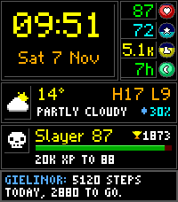
  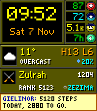

  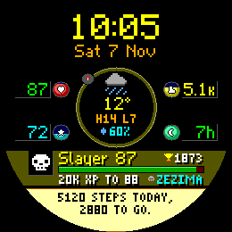
  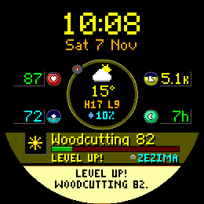
   On the Pebble Round 2 (beta): the minimap layout

<!-- PHOTO: replace with a real on-wrist photo of a Pebble Time 2 running the face

-->

## Install

**[Get Gielinor HUD on the Pebble appstore](https://apps.repebble.com/b23f973d0f0141e9b99f114a)**
(iPhone and Android).

Then, in the Pebble app, open the face's **Settings** and enter your character name.

**Or install the file yourself:**

1. On your phone, download `GielinorHUD-<version>.pbw` from the
   [latest release](https://github.com/TechnoidAlpha/gielinor-hud-pebble/releases/latest).
2. Open the file and choose the Pebble app. It installs the face to your watch.
   - **iPhone:** tap the download in Safari (or find it in the Files app), then share it to
     **Pebble**.
   - **Android:** tap the download, or open it from a file manager. If the Pebble app isn't
     offered, try [Rebble's Sideload Helper](https://help.rebble.io/sideloading/).

## Features

Top to bottom, the screen shows:

| On screen | What it shows |
|---|---|
| **Clock** | The time and date in big pixel numbers with drop shadows, in an original OSRS-style font. Follows your watch's 12/24-hour setting. |
| **Status orbs** | Four orbs, coloured green to red like the game's: battery, heart rate, steps and sleep, or the stats you choose. [More](#status-orbs) |
| **Weather** | Temperature, conditions, today's high and low, and the chance of rain or snow, from your phone's location or a city you choose. |
| **Hiscores** | Your real Old School RuneScape or RuneScape 3 stats, with an XP bar to your next level. Six ways to show them, including a boss kill count and a Grand Exchange price. [More](#hiscores-panel) |
| **Chatbox** | Short messages that take turns: a rain countdown, sunset, steps left, XP to your next level, level-ups and more. [More](#chatbox) |

And around it:

- **Three themes:** Classic stone, Dark like the modern client, and Bright for reading in
  sunlight.
- **Pebble Round 2 (beta):** its own round layout in the style of the game's minimap.
  [More](#pebble-round-2-beta)
- **Settings with a live preview** of the face, so you see every change as you make it.
  [More](#settings)
- **Makes room for Timeline Quick View** instead of hiding under it.
- **No blank screen.** Come back from Timeline, Health or an app and the frame, clock and date
  are there at once.
- **Gentle on battery.** It redraws once a minute, and your phone does all the fetching.
- **No accounts, no API keys, no ads.** Free, with [original art](#original-work).

### Status orbs

These are the defaults. In Settings each orb can show battery, heart rate, steps, sleep, active
minutes, distance or calories instead, each against its own daily goal.

| Orb | Shows |
|:---:|-------|
|  Hitpoints | Watch battery (cyan while charging) |
|  Prayer | Heart rate |
|  Run energy | Steps today (it fills towards your daily goal) |
|  Special attack | Sleep so far against your goal |

### Hiscores panel

Works with Old School RuneScape (Regular, Ironman, Hardcore and Ultimate) and RuneScape 3
(Regular, Ironman and Hardcore). Turn on one game or both, each with its own character. With
both on, the panel switches between them every minute or at your rotate speed, or keeps Old
School in the panel and puts RuneScape 3 in the chatbox. Choose what it shows:

| Mode | Shows |
|------|-------|
| One skill | The skill of your choice, plus your total level |
| Rotate | A different skill every 1, 5, 15 or 60 minutes |
| Closest to a level-up | The skill you're nearest to levelling |
| XP gained today | Today's XP, plus your top skill of the day |
| Kill count | A boss or clue scroll total of your choice, with your rank (Old School) |
| GE price | One Grand Exchange item's price and how it moved since yesterday (prices from the OSRS Wiki) |

The skill modes have an XP bar to your next level. Every skill has its own icon, from Sailing to
Necromancy.

Two extras, each with a switch in Settings:

- **Level-up moments.** When a refresh finds a new level, the panel shows it with fireworks and the
  chatbox congratulates you, for an hour.
- **Account helms.** A small Ironman, Hardcore or Ultimate helm beside your name.

### Chatbox

Choose which of these take turns, one each minute:

- **Weather:** rain or snow on the way (a countdown when it's under two hours), the next sunrise
  or sunset, the feels-like temperature, and wind speed and direction
- **You:** steps left to your daily goal, and charging while the watch is on its charger
- **Game:** XP to your next level, level-ups, and your Grand Exchange item's price
- **Other:** Welcome to Gielinor

With none chosen, the chatbox shows the date. Warnings always come first: battery at 15% or
less, phone disconnected, and Pebble Health turned off.

## Settings

Open the Pebble app, find **Gielinor HUD** under your watchfaces and tap **Settings**. A live
preview of the face sits at the top and shows each change as you make it.

- **Hiscores:** Old School, RuneScape 3 or both, each with its own character and account
  type; what the panel shows; your skill, picked from a grid laid out like the in-game skills tab
- **Weather:** phone GPS or a typed city, Celsius or Fahrenheit, how often to refresh
- **Orbs:** what each orb shows (battery, heart rate, steps, sleep, active minutes, distance or
  calories) and your goals
- **Chatbox:** which messages it shows, grouped by weather, you and the game
- **Look:** the theme, with a preview of each

On a Pebble Round 2 the preview shows the round layout. The clock follows your watch's 12/24-hour
setting.

<table>
  <tr>
    <td align="center" width="50%"> <b>Hiscores</b>: game, character and panel</td>
    <td align="center" width="50%">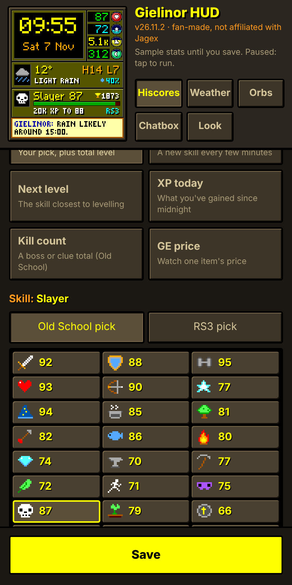 <b>Skill picker</b>, laid out like the skills tab</td>
  </tr>
  <tr>
    <td align="center">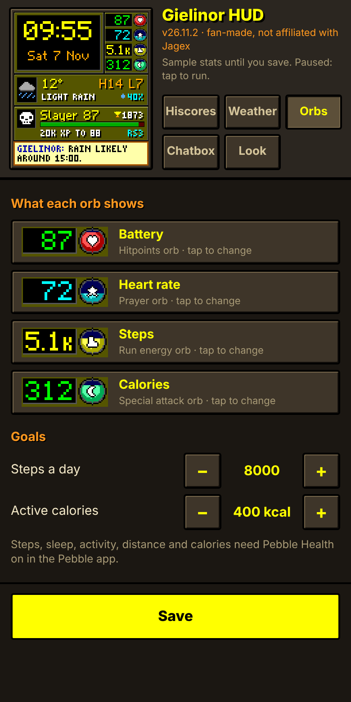 <b>Orbs</b>: what each one shows, and your goals</td>
    <td align="center">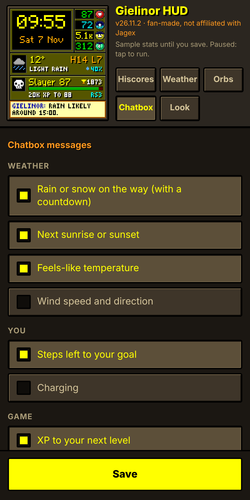 <b>Chatbox</b>: which messages appear</td>
  </tr>
  <tr>
    <td align="center">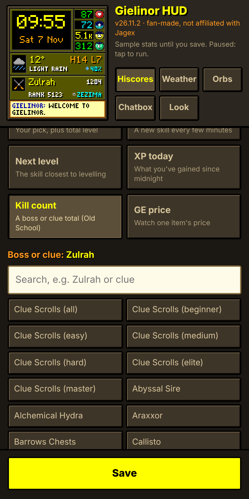 <b>Kill count</b>: pick any boss or clue</td>
    <td align="center">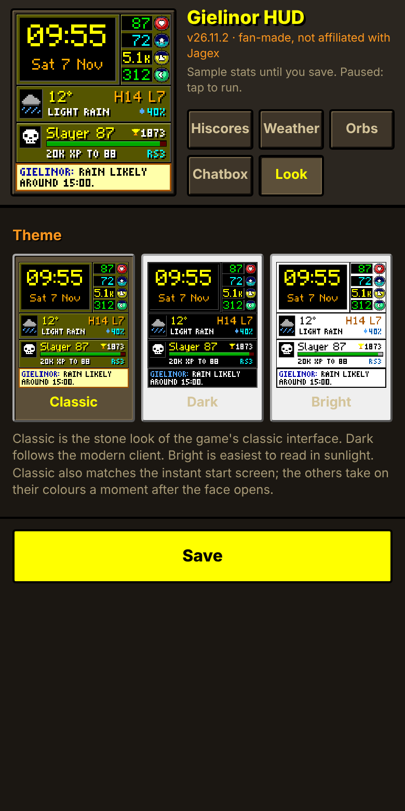 <b>Look</b>: Classic, Dark or Bright</td>
  </tr>
</table>

## Pebble Round 2 (beta)

On the round screen the face gets its own layout, modelled on the game's minimap: the clock on
top, the weather inside a minimap with its compass, two orbs either side, then the hiscores and the
chatbox following the curve. Every setting works the same, and Quick View gets a band across the
middle while the chatbox stays below it.

It's built and tested on the Round 2 emulator, but I don't have a Round 2 to try it on. If you do,
please [open an issue](https://github.com/TechnoidAlpha/gielinor-hud-pebble/issues) with a photo,
good or bad.

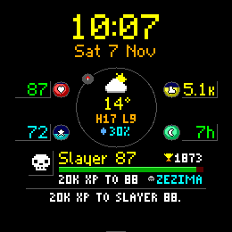 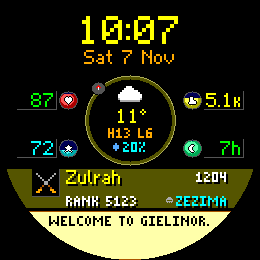

## FAQ

**Which watches does it work on?**
The Pebble Time 2 (200×228) and, in beta, the Pebble Round 2 (260×260 round). Older Pebbles
aren't supported.

**Why does the face change colour a moment after it opens?**
The watch paints the Classic frame instantly while the face starts. With the Dark or Bright theme
it then takes on your theme's colours, a fraction of a second later.

**The GE price says the item wasn't found.**
Type the item's name as it appears in the game, for example "Abyssal whip". Part of a name works
too: the first item that contains it is used.

**The weather has gone grey.**
The face greys out weather that is more than 3 hours old and shows its age instead of the
conditions. It usually means your phone hasn't been able to reach the internet, or the Pebble
app was closed by the phone's battery saver. It recovers on its own once the phone is back.

**The hiscores panel says my name wasn't found.**
Check the spelling, the game (Old School or RuneScape 3) and the account type in Settings.
Old School accounts only appear on the hiscores once they rank in a skill. For RuneScape 3 the
face reads your RuneMetrics profile, so set it to public in RuneScape's settings if the panel
says "profile private".

**How often do the hiscores update?**
Every 3 hours, and whenever you change a setting. "XP gained today" counts from the first
update after midnight.

**The orbs show `--`.**
Steps, heart rate and sleep need Pebble Health turned on in the Pebble app, and the chatbox tells
you if the face isn't allowed to read it. Heart rate also needs the watch on your wrist. The
Special orb counts sleep over the last 24 hours, so last night's sleep shows all day.

**Can I suggest a feature or report a bug?**
Yes, please [open an issue](https://github.com/TechnoidAlpha/gielinor-hud-pebble/issues).

## Privacy

The face has no server of its own and collects nothing. Your phone only talks to these public
services:

- [Open-Meteo](https://open-meteo.com/) receives your approximate location (or the city you
  typed) to fetch the weather.
- Jagex's official hiscores (`secure.runescape.com`, plus RuneMetrics at `apps.runescape.com`
  for RuneScape 3) receive the character name you entered.
- If you use the price watch, the [OSRS Wiki's prices API](https://prices.runescape.wiki/)
  receives the item you chose.

Your settings stay on your phone. Health data never leaves the watch.

## Original work

Everything you see on the watch was made from scratch for this face. No files from Old School
RuneScape or RuneScape are in this repository or in the watchface: no sprites, icons, fonts,
screenshots, sounds or logos.

- **Icons:** all 49 (weather, orbs, every skill in both games, helms, clue scroll, coins and the
  rest) are original pixel art. Each
  one is a line of text in [`src/embeddedjs/main.js`](src/embeddedjs/main.js), so you can read
  every pixel.
- **Fonts:** the pixel fonts are drawn letter by letter as text in
  [`tools/genfont.py`](tools/genfont.py), which builds them.
- **Pictures in this README:** screenshots of the face running in the Pebble emulator and of
  its own settings page, plus a banner and demo put together from those screenshots by
  [`tools/banner.py`](tools/banner.py) and [`tools/demo_gif.py`](tools/demo_gif.py).
- **Layout:** the orbs, stone panels, minimap and chatbox are a tribute to the game's interface,
  redrawn for a 200×228 watch screen and a 260×260 round one.
- **Your stats:** fetched live from Jagex's public hiscores. None of their data ships with the
  face.

The game and skill names are only used to say what the face works with. They are trademarks of
Jagex. The face is free and makes no money.

## Credits

- Made by [Technoid](https://github.com/TechnoidAlpha) in answer to
  [a request on r/pebble](https://www.reddit.com/r/pebble/comments/1xm2j8j/request/) for an OSRS watchface.
- Weather data by [Open-Meteo.com](https://open-meteo.com/) (CC BY 4.0).
- Grand Exchange prices from the [OSRS Wiki](https://prices.runescape.wiki/).

## Disclaimer

Gielinor HUD is a free, unofficial fan project. It is not endorsed by or affiliated with Jagex.
It contains no art, audio or other content from Jagex's games (see [Original work](#original-work)).
Old School RuneScape and RuneScape are trademarks of Jagex Limited.

## Licence

[MIT](LICENSE). Free to use, change and share.
